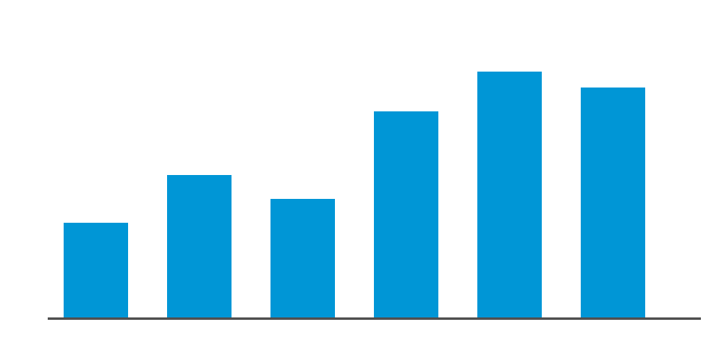

# Where we are

Progress against the Q3 plan and what changes next quarter.

## Executive Summary

The migration is on track for the November cut-over, with two risks needing a decision.

- **Scope:** 14 of 18 services migrated to the new runtime
- **Cost:** run-rate down 22% versus Q2 after rightsizing
- **Quality:** change failure rate fell from 18% to 9%
- **Risks:** vendor licence renewal and the payments freeze window

> **Decision needed:** approve the extended freeze window for payments (2 weeks) by 15 Oct.

## Key Numbers

- **14/18** services migrated
- **22%** lower run-rate
- **9%** change failure rate
- **3** P1 incidents, down from 7

## Revenue Trend



## What We Heard From Teams

> The new pipeline cut our release time from two days to forty minutes, and nobody misses the change board. — Payments squad lead

## Detailed Workstream Status

| Workstream | Owner | Status | Notes |
|---|---|---|---|
| Runtime migration | A. Rao | On track | 14 of 18 services moved; remaining 4 depend on the payments freeze window being approved |
| CI/CD pipeline | J. Kim | Done | All squads on the new pipeline since August; legacy Jenkins decommissioned |
| Observability | M. Ortiz | At risk | Log volume 40% above estimate; sampling policy under review with security |
| Cost optimisation | S. Patel | On track | Rightsizing complete for compute; storage tiering starts in October |
| Identity integration | L. Chen | Delayed | Waiting on vendor SSO connector release, now expected mid-November |
| Data platform | R. Gomez | On track | Warehouse migration rehearsal passed with zero data loss |
| Security hardening | T. Nwosu | On track | CIS benchmarks applied to 90% of hosts; exceptions logged |
| Disaster recovery | P. Ivanova | At risk | Failover test showed 3h RTO against a 1h target; network fix in progress |
| Developer portal | K. Osei | Done | Self-service templates live; 60% of new services created via portal |
| Training | H. Silva | On track | 210 engineers trained; advanced track opens in November |

## Lessons Learned

- Start dependency mapping before the first migration wave, not during it, because late discoveries caused most of the slippage in waves two and three
- Budget explicitly for observability volume; our estimate assumed the old sampling rates and was 40% low
- Pair every migrated service with an owner on call for the first two weeks after cut-over
- Keep the freeze calendar visible to all squads in the portal so nobody plans releases into a freeze
- Rehearse data migrations end to end at production volume at least twice before the real run
- Treat vendor dependencies as risks from day one, with a named owner and a fallback plan
- Automate the runbook checks we repeated by hand in every wave
- Celebrate each wave; morale visibly improved after we started short demos
- Write decisions down in the decision log the same day they are made, with the reason
- Keep steering updates to one page and push detail into the appendix

## Rollout Plan

1. **Approve freeze window**: steering decision by 15 Oct
2. **Migrate payments**: during the approved two-week window
3. **Fix DR network path**: bring RTO under the 1h target
4. **Cut over**: final traffic switch in late November
5. **Decommission legacy**: retire old runtime by end of December

## Deployment Command

```
./deploy.sh --env prod --wave 4 --services payments,ledger
./verify.sh --env prod --smoke
```

## Approach

This section was written as plain prose rather than slide bullets. The team agreed to move remaining services in a single wave once the payments freeze is approved, because splitting the wave would double the number of change windows and the coordination cost that comes with them.

We also agreed that observability sampling will be decided jointly with security, so that retention meets audit needs without the 40% cost overrun we saw this quarter.
